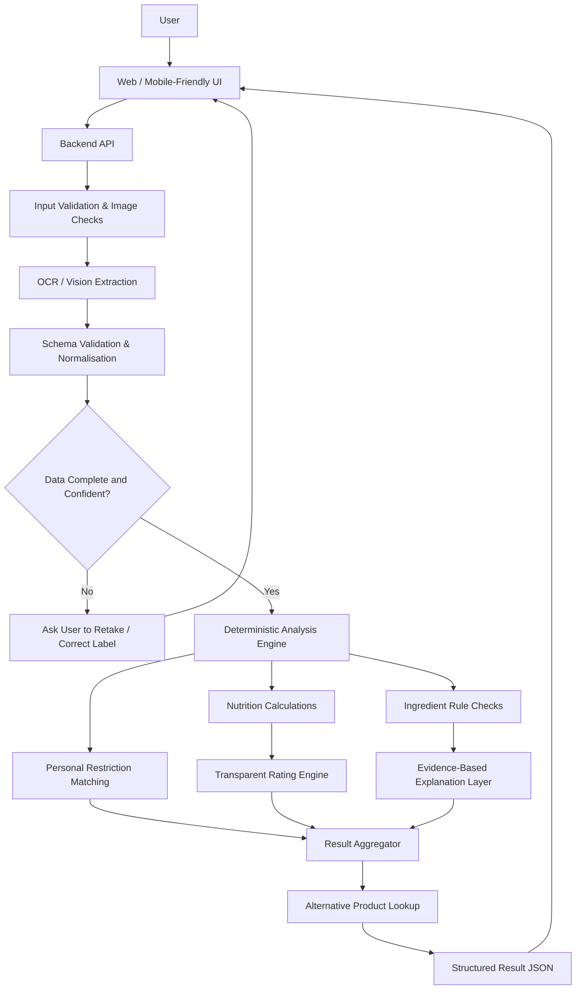

# LabelLens AI — System Architecture & Workflow

> **Purpose:** A practical architecture for an AI-powered food-label analysis application.
>
> **MVP principle:** Use AI for label understanding and explanation, deterministic code for calculations and restriction matching, and verified data sources for product comparisons. Never treat an AI-generated answer as a medical diagnosis or a guarantee that a food is safe.

---

## 1. Product Scope

LabelLens AI allows a user to upload or capture a photo of a packaged-food label and receive:

- Extracted ingredients and nutrition facts.
- A nutrition dashboard: calories, protein, carbohydrates, sugars, fat, saturated fat, sodium/salt, fibre, and listed micronutrients.
- Ingredient explanations with evidence/context and uncertainty.
- A transparent product rating with a visible breakdown.
- User-specific dietary preference and allergen **match checks**.
- Comparable alternatives when verified product data is available.
- Serving-size context and general dietary guidance.

### Important distinction

Keep these results separate:

1. **General nutrition profile** — how the product compares with the selected, documented nutrition criteria.
2. **Personal restriction match** — whether the label appears to contain an ingredient matching a user-declared restriction.
3. **Data confidence** — how complete and readable the source label is.

A product can score well nutritionally and still match a user's allergen restriction. A green score must never override a detected allergen or uncertain label.

---

## 2. High-Level Architecture



### Component responsibilities

| Component | Responsibility | Recommended MVP implementation |
|---|---|---|
| User interface | Upload photo, show progress, collect optional preferences, display result | React + Tailwind CSS |
| Backend API | Orchestrate pipeline and protect API keys | Next.js Route Handler or server-side API route |
| Input validation | Validate file type, size, dimensions and upload limits | Server-side validation |
| Vision/OCR extraction | Read ingredients and nutrition table from the image | Gemini vision model or another chosen multimodal API |
| Schema validation | Require predictable fields and normalise units | Zod or equivalent |
| Analysis engine | Compute nutrition metrics and apply transparent rules | Plain TypeScript functions |
| Ingredient explanation | Explain ingredient purpose and supported concerns | Curated reference data first; AI summarisation only from supplied evidence |
| Restriction matcher | Compare parsed ingredients with user-selected restrictions | Deterministic rules + synonym list |
| Rating engine | Calculate a reproducible score and explain deductions | Versioned, documented formula |
| Alternatives service | Find comparable products with stronger relevant metrics | Open Food Facts or a curated product list |
| Result aggregator | Assemble all outputs and warnings | Backend service |
| Deployment | Host the web app and server route | Vercel or Firebase, depending on chosen stack |

---

## 3. End-to-End User Workflow

1. **Open the app** — user lands on the scanner page.
2. **Add a label image** — take a photo or upload an image of the ingredients and nutrition panel.
3. **Validate the upload** — check image format, size and basic readability. Reject unsupported files.
4. **Extract label data** — vision model returns only structured fields, not a free-form health verdict.
5. **Validate the extraction** — verify the response schema, required fields, units, numeric ranges and missing values.
6. **Request correction if needed** — if the label is blurry, cropped or incomplete, ask the user to retake it or edit extracted text.
7. **Run deterministic checks** — calculate per-serving/per-100 g values, compare nutrition criteria, and match declared restrictions.
8. **Build ingredient explanations** — attach known purpose/evidence/context to ingredients; label uncertain claims and avoid unsupported causal claims.
9. **Calculate product rating** — use a documented, versioned formula. Do not silently change weights.
10. **Find alternatives** — query a product source, filter for comparable category and available nutrition data, then rank against the user's stated goal.
11. **Aggregate results** — include findings, provenance, warnings, score breakdown and confidence.
12. **Display the report** — show nutrition, ingredient dashboard, restriction matches, rating and alternatives.
13. **Allow correction/feedback** — let the user correct extraction mistakes and flag a poor recommendation.

---

## 4. Suggested Repository Structure

```text
labellens-ai/
├── app/
│   ├── page.tsx                     # Landing/scanner page
│   ├── scan/
│   │   └── page.tsx                 # Upload and analysis experience
│   ├── results/
│   │   └── [scanId]/
│   │       └── page.tsx             # Result dashboard (optional for MVP)
│   ├── api/
│   │   ├── analyze/
│   │   │   └── route.ts             # Main server-side orchestration endpoint
│   │   └── alternatives/
│   │       └── route.ts             # Optional alternative lookup endpoint
│   ├── components/
│   │   ├── ImageUploader.tsx
│   │   ├── NutritionDashboard.tsx
│   │   ├── IngredientList.tsx
│   │   ├── RestrictionAlerts.tsx
│   │   ├── ProductRating.tsx
│   │   ├── AlternativeProducts.tsx
│   │   └── ConfidenceNotice.tsx
│   └── lib/
│       ├── validation.ts            # File + request validation
│       ├── schemas.ts               # Zod response/input schemas
│       ├── units.ts                 # Unit normalisation
│       ├── nutrition.ts             # Nutrition calculations
│       ├── restrictions.ts          # Restriction matching rules
│       ├── rating.ts                # Documented rating formula
│       ├── ingredients.ts            # Ingredient rules/reference mapping
│       ├── alternatives.ts           # Product lookup and ranking
│       └── result.ts                # Final response assembly
├── public/
│   └── icons/
├── tests/
│   ├── nutrition.test.ts
│   ├── restrictions.test.ts
│   ├── rating.test.ts
│   └── extraction-fixtures/
├── .env.example
├── .gitignore
├── README.md
└── package.json
```

This structure assumes Next.js App Router. If the project uses plain React/Vite, keep the same logical modules but place the backend API in a separate server or serverless function. Do not put API keys in browser-side code.

---

## 5. API Contract

### Request: `POST /api/analyze`

Use `multipart/form-data` with:

- `image`: image file containing the label.
- `preferences` (optional): JSON string with user-selected restrictions/goals.
- `locale` (optional): language/region, e.g. `en-IN`.

Example preferences:

```json
{
  "allergens": ["peanut", "milk"],
  "diet": ["vegetarian"],
  "goals": ["lower-sugar"],
  "servingSizeGrams": 30
}
```

### Internal extraction schema

Ask the vision model to return JSON matching a strict schema:

```json
{
  "productName": null,
  "brand": null,
  "category": null,
  "ingredientsText": "Example ingredient list from the label",
  "ingredients": ["ingredient A", "ingredient B"],
  "nutrition": {
    "basis": "per_100g",
    "servingSize": 30,
    "servingUnit": "g",
    "caloriesKcal": 450,
    "proteinG": 8,
    "carbohydratesG": 70,
    "totalSugarsG": 20,
    "addedSugarsG": null,
    "totalFatG": 15,
    "saturatedFatG": 5,
    "transFatG": null,
    "sodiumMg": 400,
    "saltG": null,
    "fibreG": 4,
    "micronutrients": [],
    "allergenStatements": [],
    "mayContainStatements": []
  },
  "missingFields": ["addedSugarsG"],
  "uncertainFields": ["ingredientsText"],
  "extractionNotes": ["Nutrition table partially cropped"]
}
```

The numbers above are **illustrative placeholders**, not real product data. Missing data must be represented as `null` or an empty list, not guessed.

### Response: analysis result

```json
{
  "product": {
    "name": "Example product",
    "category": "snack"
  },
  "nutrition": {
    "per100g": {},
    "perServing": {},
    "missingFields": []
  },
  "ingredientFindings": [
    {
      "ingredient": "Example ingredient",
      "purpose": "Label-derived or verified purpose",
      "evidenceSummary": "Evidence-based explanation, with source",
      "context": "Effect depends on amount and dietary context",
      "severity": "informational",
      "confidence": "medium",
      "sourceIds": []
    }
  ],
  "restrictionChecks": [
    {
      "restriction": "peanut",
      "status": "match | no_match_detected | uncertain",
      "matchedText": null,
      "message": "A no-match result does not guarantee safety."
    }
  ],
  "rating": {
    "score": 0,
    "band": "amber",
    "formulaVersion": "v1",
    "breakdown": [],
    "limitations": []
  },
  "alternatives": [],
  "dataQuality": {
    "confidence": "medium",
    "warnings": []
  }
}
```

Treat these examples as contracts to adapt during implementation. Avoid returning unsupported claims or fabricated source IDs.

---

## 6. Processing Pipeline in More Detail

### A. Image ingestion and safety

- Accept only allowed image formats.
- Enforce a file-size limit and image dimension limit.
- Reject empty, corrupted or unsupported files.
- Avoid logging raw images or sensitive preference data by default.
- Keep the model API key on the server.
- Apply request throttling and reasonable usage limits.

### B. AI extraction

Prompt the vision model to **transcribe what is visible**, not decide whether the food is healthy.

Require it to:
- Preserve the original ingredient wording.
- Extract nutrition values and units.
- Identify whether the values are per serving or per 100 g/ml.
- Distinguish “contains” statements from “may contain” statements.
- Return `null` for unreadable/missing fields.
- Mark uncertainty and note cropped or blurry sections.
- Never infer unlisted nutrients or ingredients.

### C. Validation and normalisation

- Validate the model output against a strict schema.
- Normalise units without losing original values.
- Check that values are numeric and within plausible ranges.
- Keep `unknown` distinct from zero.
- Detect conflicting values and ask the user to review them.
- Preserve a reference to the source text/image region where feasible.

### D. Deterministic analysis

Use ordinary code for calculations and matching:

- Convert per-serving values to per-100 g/ml only when serving basis and units are known.
- Compare nutrition metrics with a documented, region-appropriate standard.
- Match ingredients against selected restrictions using normalised names and synonyms.
- Keep advisory “may contain” statements visible as separate warnings.
- Make the output reproducible for the same input and rule version.

### E. Evidence and explanation

For each flagged ingredient, store or retrieve:
- Ingredient name and synonyms.
- Common technological purpose.
- Evidence-supported effect or concern.
- Context, such as dose, frequency, population and uncertainty.
- Trusted source name, URL and last-reviewed date.

Do not ask a language model to invent citations. Prefer curated, trusted references. If no reliable evidence is available, say so.

### F. Rating engine

Use a transparent, versioned rating system. A practical MVP can use a small number of clearly described nutrition indicators rather than pretending to provide a universal medical score.

Possible displayed dimensions:
- Sugar
- Sodium/salt
- Saturated fat
- Fibre
- Protein
- Overall data completeness

Show the component values and scoring rules. Keep the personal restriction result separate from the general nutrition score. Do not let a high nutrition score cancel an allergen match.

### G. Alternatives engine

1. Search a verified source such as Open Food Facts or a maintained catalogue.
2. Filter for comparable category and available nutrition data.
3. Exclude products that conflict with explicitly selected preferences when data is sufficient.
4. Rank candidates against the user's chosen goal, such as lower sugar or higher fibre.
5. Display the comparison basis, data source and missing information.
6. If no trustworthy matches exist, say “No verified alternative found” rather than inventing products.

---

## 7. Dashboard Layout

Suggested order on the result screen:

1. **Product summary** — product name, category, extracted label quality.
2. **Overall nutrition indicator** — green/amber/red with text explanation and rating breakdown.
3. **Personal restriction alerts** — displayed prominently and independently of the rating.
4. **Nutrition dashboard** — calories, protein, carbohydrates, total/added sugars when listed, total/saturated/trans fat when listed, sodium/salt, fibre and listed micronutrients.
5. **Ingredient intelligence** — ingredient, purpose, evidence/context, confidence and source.
6. **Serving context** — per serving vs per 100 g/ml, with general guidance.
7. **Alternatives** — comparable products with side-by-side nutrition values.
8. **Data-quality panel** — missing, uncertain or unreadable label fields.
9. **Disclaimer** — informational tool; not a diagnosis or guarantee of allergen safety.

### Colour semantics

- **Green:** favourable against a stated criterion, with adequate data.
- **Amber:** mixed results, borderline result, missing data or uncertainty.
- **Red:** a clearly defined criterion is exceeded or a user restriction match is detected.

Always pair colour with text/icons so the interface remains understandable for colour-blind users. A red flag is not proof that an ingredient is universally dangerous; a green status is not a guarantee that a product is safe for every person.

---

## 8. Privacy, Security and Reliability

- Never expose API keys in client code or public GitHub history.
- Validate all inputs server-side; treat model output as untrusted input.
- Use a strict schema and escape rendered label text.
- Apply rate limiting and sensible upload limits.
- Minimise retention of images and dietary preferences.
- Obtain consent before storing scan history.
- Keep logs free of raw images, API keys and unnecessary personal data.
- Include source links and versioned rules for explainability.
- Add unit tests for unit conversion, scoring, missing values and restriction matching.
- Provide graceful errors for model/API failures and low-confidence extraction.
- Make clear that label parsing may miss ingredients; users with serious allergies should verify the physical packaging and consult appropriate professional guidance.

---

## 9. Testing Checklist

- [ ] Clear label with complete nutrition table.
- [ ] Blurry or partially cropped label.
- [ ] Product with no nutrition table.
- [ ] Nutrition values per serving vs per 100 g.
- [ ] Missing added-sugar or fibre value.
- [ ] “Contains” and “may contain” statements.
- [ ] Ingredient synonym and spelling variation.
- [ ] User restriction match and no-match result.
- [ ] Conflicting or implausible model output.
- [ ] Product with insufficient data for a rating.
- [ ] No verified alternatives available.
- [ ] API timeout or invalid model response.
- [ ] Mobile layout, keyboard navigation and colour-independent alerts.

---

## 10. Two-Hour Hackathon MVP Plan

### First 20 minutes — scaffold
- Create React/Next.js project and scanner page.
- Build upload control and a result-page skeleton.
- Configure server-side environment variable for the AI API.

### Minutes 20–50 — extraction
- Implement `/api/analyze`.
- Send label image to the vision model.
- Parse and validate structured JSON.
- Show extracted ingredients and nutrition values.

### Minutes 50–75 — deterministic analysis
- Implement serving/per-100 g calculations where possible.
- Add restriction matching and a small, documented rating formula.
- Add explicit missing-data and uncertainty states.

### Minutes 75–100 — dashboard
- Add nutrition cards, ingredient explanations and green/amber/red statuses.
- Ensure personal restriction alerts are separate from the overall rating.

### Minutes 100–115 — alternatives and testing
- Integrate a product lookup if feasible; otherwise clearly label alternatives as unavailable until verified data is connected.
- Test blurry images, missing fields and API errors.

### Minutes 115–120 — release
- Deploy, test the public URL on desktop/mobile, remove secrets from the repository, and document setup in README.

**Priority order if time is running out:** real extraction → schema validation → nutrition dashboard → restriction checks → transparent rating → alternatives.

---

## 11. Recommended Build Decision

For a fast web MVP, use:

- **Frontend:** Next.js + React + Tailwind CSS.
- **AI:** Gemini multimodal API or an equivalent vision-capable model.
- **Validation:** Zod.
- **Logic:** TypeScript functions for nutrition calculations, restriction matching and scoring.
- **Product data:** Open Food Facts or another verified catalogue.
- **Hosting:** Vercel or Firebase Hosting with a secure server-side function.
- **Testing:** Vitest or another lightweight test runner.

Keep the architecture modular. The first release can run without accounts or a database. Add scan history, saved preferences and analytics only after the core extraction and validation pipeline is reliable.

---

## 12. Definition of Done

The MVP is ready for judging when a user can:

1. Upload a real label image.
2. See structured extracted data and missing-field warnings.
3. Review nutrition values without guessed numbers.
4. Receive a reproducible rating with an explanation.
5. See personal restriction matches separately from the rating.
6. Read ingredient explanations with evidence/context or an explicit “evidence not available” state.
7. See verified alternatives or a clear message that none were found.
8. Use the app on a phone.
9. Understand the limits of the output and verify the physical package when necessary.

**Core design rule:** AI extracts and explains; validated code calculates and matches; trusted data sources ground evidence and alternatives; the interface communicates uncertainty.
